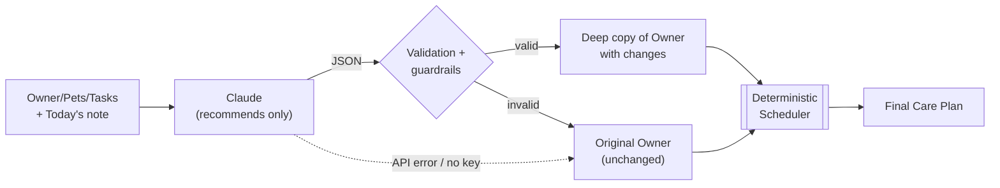

# 🐾 PawPal AI Care Planner

PawPal AI Care Planner extends my original **PawPal+** pet-care scheduler with a constrained
AI planning layer. A pet owner describes today in plain language, for example "Mochi needs
her medication tonight… I only have 45 minutes". Claude turns that note into a small,
structured recommendation, and strict guardrails validate it. The original deterministic
Scheduler still builds the final plan. **Claude never creates the schedule directly.** It
can only suggest limited changes, and if anything goes wrong the app falls back to the
original Scheduler.

---

## Original project: PawPal+ (Module 2 base project)

PawPal+ was my Module 2 project. It is a Streamlit app in which an owner manages multiple
pets and their care tasks; each task has a duration, a priority, a start time, a
recurrence, and a due date. Its deterministic `Scheduler` builds a daily plan by priority
(high first, shorter tasks first on ties) within the owner's available minutes, and it
explains why each task was scheduled or skipped. The app also sorts and filters tasks,
creates the next occurrence of daily or weekly tasks, and detects tasks booked at the same
time.

| | Original PawPal+ (Module 2) | New in the final project |
|---|---|---|
| Core | `Owner` / `Pet` / `Task` / `Scheduler` in `pawpal_system.py` | `ai_planner.py` (AI layer on top, core unchanged) |
| Input | Forms for pets and tasks | **Natural-language "Today's situation" note** |
| Planning | Deterministic priority + time-budget scheduling | Claude recommends priority/time changes → validated → same Scheduler |
| Reliability | 17 unit tests | 31 additional AI/guardrail tests, logging, safe fallback |
| Docs | UML, reflection | Architecture diagram, `evaluation.md`, `model_card.md` |

---

## The new AI Care Planner

1. **The owner enters context** in the Streamlit "AI Care Planner" section.
2. **Claude receives limited task context:** the owner's available minutes and each pet's pending tasks due today. Every task has a short ID (`t1`, `t2`, …), so Claude refers to real tasks instead of inventing names.
3. **Claude recommends, as structured JSON:**
   - priority changes for existing tasks;
   - optionally, a **smaller or unchanged** time budget;
   - a short reason for each change and a one-sentence summary.
4. **Strict validation and guardrails** check the entire response.
5. **Valid changes are applied to a deep copy** of the Owner. The user's real data is never modified.
6. **The deterministic Scheduler** (the unchanged original code) creates the final schedule from that copy.
7. **Fallback:** an invalid response, an API failure, a missing key, or a blank note means the original Scheduler runs on the original Owner. The UI says clearly that the standard plan was used.

> **Claude does NOT create the final schedule.** It can only adjust priorities and shrink
> the time budget. The deterministic Scheduler is always the final scheduling authority.

---

## Architecture

The authoritative diagram is [`diagrams/architecture.mmd`](diagrams/architecture.mmd).
A simplified version:



---

## Setup and run (Windows PowerShell)

```powershell
git clone https://github.com/ustafandy/pawpal-ai-care-planner.git
cd pawpal-ai-care-planner
python -m venv .venv
.venv\Scripts\Activate.ps1
pip install -r requirements.txt

# Optional: enables real AI recommendations (use your own key; never commit it)
$env:ANTHROPIC_API_KEY = "<your-anthropic-api-key>"

streamlit run app.py      # web app
python -m pytest          # automated tests (no API key needed)
```

- **Without an API key** the app works fully. The AI section shows a warning and returns the standard deterministic plan.
- **Real AI recommendations** need your own Anthropic API key. Each click of **Generate AI Care Plan** sends one paid API request.
- The key is read only from the `ANTHROPIC_API_KEY` environment variable. It is never hardcoded, logged, or displayed.
- `python main.py` still runs the original CLI demo, which does not use AI.

---

## Sample interactions

### A. Successful real AI run (manually verified)

*One manually verified real Anthropic API run. This is a demonstration, not a consistency benchmark.*

- **Input:** "Mochi needs her medication tonight. Biscuit has a lot of energy today, but I only have 45 minutes."
- **Claude recommended:** raise Mochi's **Medication** from **medium → high**.
- **Validation:** passed (✅ "AI recommendation passed validation").
- **Effective minutes:** 45.
- **Scheduled:**
  1. Mochi, Medication (10 min, high)
  2. Biscuit, Feed (10 min, high)
- **Skipped:** Biscuit, Walk (30 min, high). The three high-priority tasks totaled 50 minutes, but only 45 were available.

This shows the split of responsibilities. Claude decided what mattered more, and the
deterministic Scheduler enforced the time limit.

### B. Guardrail violation: AI tries to add time

*From the automated test `test_ai_cannot_increase_available_time_beyond_owner_setting`.*

- **Setup:** the owner has 45 minutes, but the AI response returns `"available_minutes": 120`.
- **Result:** the **entire** recommendation is rejected (all-or-nothing).
- **UI:** ⚠️ "The AI planner was not used… PawPal+ safely used the standard deterministic scheduler instead." The guardrail note says `available_minutes 120 is outside 1..45`.
- **Plan:** the standard deterministic plan, with effective minutes still 45.

### C. Missing API key / API unavailable

*From the automated tests `test_missing_api_key_falls_back_without_calling_the_api` and `test_api_client_failure_falls_back`.*

- **Setup:** `ANTHROPIC_API_KEY` is not set, or the API or network fails.
- **Result:** no request is sent when the key is missing. The planner logs the problem and falls back.
- **UI:** a warning plus the guardrail note "AI was unavailable (ANTHROPIC_API_KEY is not set), so the standard plan was used."
- **Plan:** the normal deterministic plan, so the app stays fully usable.

---

## Reliability and testing

```powershell
python -m pytest
```

**48 tests pass:**
- **17** original PawPal+ tests: scheduling, sorting, filtering, recurrence, conflicts, edge cases.
- **31** AI and reliability tests in `tests/test_ai_planner.py`. They use **fake AI clients**, so they run offline, need no API key, and make **no paid API calls**.

**Key guardrails.** The whole response is rejected if any of these fail:
- exact JSON schema, with no extra or missing fields;
- task IDs must exist and match their pet;
- priority must be `low`, `medium`, or `high`;
- an owner-set **high** priority is never lowered;
- `available_minutes` must be `null` or between 1 and the owner's setting;
- no duplicate task IDs.

API failures, a missing key or SDK, and blank notes also fall back safely. Logging records
each request, validation result, failure, and fallback, without secrets.

Every test case, plus the real run, is listed in **[evaluation.md](evaluation.md)**.

---

## Responsible AI and limitations

- Claude's recommendations can vary between runs, and only one real run was verified.
- The Scheduler's "shorter first" rule can push out longer tasks such as walks.
- Claude can only change priorities, so ideas like "shorten the walk" can't be acted on.
- Pet names, task titles, and the owner's note are sent to Anthropic.
- The plan is **not veterinary advice**.

Prompt-injection risks are limited by the guardrails: high-priority tasks can't be lowered,
time can't increase, and tasks can't be added or deleted. A medium task *can* still be
lowered to low.

The full discussion is in **[model_card.md](model_card.md)**.

---

## Design decisions and trade-offs

- **The deterministic Scheduler is the final authority.** The AI influences only its inputs, so plans stay explainable and the time limit is always enforced by code.
- **Planning happens on a deep copy.** The user's saved tasks can never be changed by AI, and `pawpal_system.py` needed no changes.
- **All-or-nothing validation instead of partial acceptance.** One invalid item rejects the whole response. This is more predictable and safer, because a partly wrong answer is treated as untrustworthy. It is also easier to test and explain. The trade-off is that a mostly good answer can be discarded.
- **Narrow AI permissions.** Claude cannot create or delete tasks, change durations, times, or recurrence, or mark tasks complete.
- **Owner-set high priority is protected.** Claude can never lower it.
- **Time can only shrink.** Claude may keep or reduce the owner's minutes but never increase them. An attempted increase is a validation failure, not a silent cap.

---

## Repository structure

| File | Purpose |
|------|---------|
| `app.py` | Streamlit UI: original pet/task/schedule sections plus the new **AI Care Planner** section |
| `pawpal_system.py` | Original core classes: `Task`, `Pet`, `Owner`, `Scheduler` (unchanged) |
| `ai_planner.py` | AI layer: context building, Claude client, validation, deep-copy planning, fallback |
| `main.py` | Original CLI demo (no AI) |
| `tests/test_pawpal.py` | 17 original tests |
| `tests/test_ai_planner.py` | 31 AI/reliability tests (offline, fake clients) |
| `diagrams/architecture.mmd` | Final-project architecture diagram (authoritative) |
| `diagrams/uml.mmd`, `diagrams/uml_final.mmd` | Module 2 class diagrams |
| `evaluation.md` | Reliability evidence: test cases and the real API run |
| `model_card.md` | Purpose, guardrails, limitations, misuse, AI-collaboration reflection |
| `reflection.md` | Module 2 project reflection |
| `ai_interactions.md` | Module 2 stretch-feature template (not used for this project) |
| `requirements.txt` | `streamlit`, `pytest`, `anthropic` |

---

## What this project says about me as an AI engineer

The main thing I learned is that building an AI system is not just connecting an LLM to an
app. Most of my effort went into deciding **what the model is allowed to change**. Then I
validated its output as untrusted data, kept the original deterministic scheduler in
charge, tested how the system fails (bad JSON, made-up task IDs, attempts to add time,
missing keys), and made sure the app still works when the AI doesn't.

I built this project with help from an AI coding assistant. I made the design decisions
and reviewed and tested its suggestions, and I also changed some of them. The biggest
change was moving from partial acceptance to all-or-nothing validation. That
collaboration is documented honestly in [model_card.md](model_card.md).
